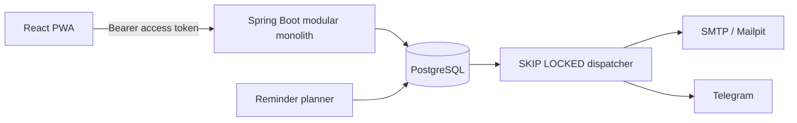

# Khayaal

Khayaal is a family medicine reminder, confirmation, stock, and refill tracker. The web app supports the daily routine, stock and refill forecasting, adherence summaries, household administration, notification preferences, printing, data export, and account deletion.

> **Safety:** Khayaal helps you remember and track. It is not medical advice. Follow your doctor's and pharmacist's instructions. All medicine information is user-entered. Khayaal does not recommend or validate doses, check interactions, place pharmacy orders, or claim to be a medical device.

## Quick start

Requirements: Docker Desktop with Docker Compose.

```bash
copy .env.example .env
docker compose up --build
```

- Web app: http://localhost:3000
- API health: http://localhost:8080/actuator/health
- OpenAPI UI: http://localhost:8080/swagger-ui.html
- Mailpit: http://localhost:8025

The checked-in defaults are for local development only. Use secrets and HTTPS outside local development. No analytics or third-party trackers are included.

## Local development

Backend (Java 21 and Maven 3.9+):

```bash
cd backend
mvn spring-boot:run
mvn verify
```

Frontend (Node 22+ and pnpm 11):

```bash
cd frontend
pnpm install --frozen-lockfile
pnpm run dev
pnpm run check
pnpm run e2e
```

When the backend contract changes, regenerate frontend API types while the backend is running:

```bash
cd frontend
pnpm run api:generate
```

## Phase 2 API walkthrough

After `docker compose up --build`, register and retain the returned access token:

```bash
curl -i -X POST http://localhost:8080/api/auth/register \
  -H "Content-Type: application/json" \
  -d '{"email":"caregiver@example.test","password":"correct-horse-battery","displayName":"Caregiver"}'
```

Use `Authorization: Bearer <accessToken>` for protected calls. Open `http://localhost:8080/swagger-ui.html` for the household, person, medicine, schedule-preview, and dose-event request schemas. Creating a scheduled medicine immediately materializes the next 14 days of dose events; repeating generation does not duplicate them.

## Architecture



## Product tour

The verified Playwright journey refreshes these screenshots automatically on desktop Chromium:

- [Today](docs/screenshots/today.png)
- [Schedule builder](docs/screenshots/schedule-builder.png)
- [Stock and refills](docs/screenshots/stock.png)

Run `pnpm run e2e` from `frontend` against the Compose stack to regenerate them from synthetic data.

PostgreSQL is both the transactional store and durable notification outbox. Dose actions and stock-ledger changes commit atomically. Multiple dispatchers can claim independent batches with `SKIP LOCKED`; deterministic dedupe keys provide at-least-once processing without duplicate planned reminders.

## Operations and performance

- Auth and invite writes use an atomic Redis-backed fixed-window rate limiter, so limits remain consistent across horizontally scaled backend instances. Client identifiers are SHA-256 hashed before they become Redis keys; the failure policy and limits are environment-configurable.
- `X-Request-ID` is accepted or generated and returned on every request. Operational metrics are available to authenticated callers under `/actuator/metrics`, including rate-limit outcomes, queue depth, dead notifications, missed doses, planner duration, and delivery outcomes.
- Synthetic load assets are in `performance/`. Results are intentionally not claimed until measured on the target machine; follow `docs/performance.md` to record k6, dispatcher, and query-plan evidence.
- Scale stateless API instances horizontally, keep one shared PostgreSQL cluster, run multiple safe outbox workers, and partition/archive old dose history only after measured need.

## Current scope

Phases 0–5 are verified. Phase 6 product routes and the main Phase 7 hardening/load-test assets are implemented; final Lighthouse measurements, full Docker-backed verification, reliability-drill evidence, and benchmark numbers must be collected on the host environment before the project-level definition of done can be claimed.

See [the project brief](docs/PROJECT_BRIEF.md), [progress](docs/PROGRESS.md), and the [architecture decisions](docs/adr/).
The consolidated release checkpoint is in [final verification](docs/verification.md).

